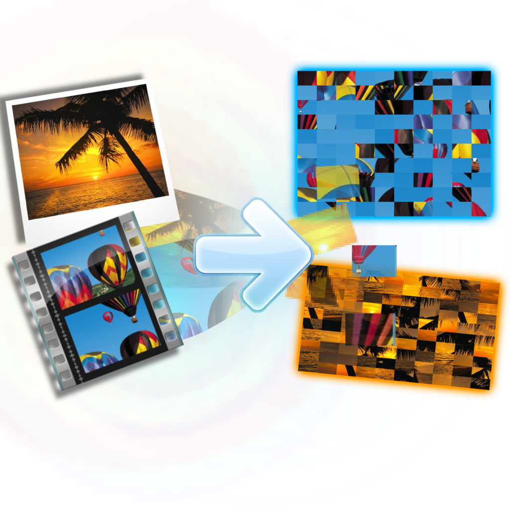

<div align="center">
  
</div>

# Media-Encrypt Studio

Welcome to **Media-Encrypt Studio**! This tool uses visual matrix scrambling and audio ring-modulation to completely encrypt your videos, images, and audio files locally. Features include custom grid size scrambling, center media overlay, advanced audio scramblers, and auto-generated SVG sequence numbered grids.

### ⚡ Auto Quality (target output size)

The **Video Quality & Format Settings** panel opens with an **Auto Quality** switch and a single slider: how much bigger (or smaller) the finished video should be than the source file (`-50% … +100%`, `0%` = the same size, `+20%` = 20% bigger). Everything else is derived from it:

- the size budget is split between the video and the audio stream,
- the bitrate is spent as CBR, so the encoded file really lands on the target (the measured size is reported after every job),
- out-of-range targets are clamped to the encoder limits and flagged,
- in Center mode the pasted video sets a quality floor, so the result can come out larger than the target.

Turn the switch off to drive the bitrate by hand. The 🌊 Dynamic Bitrate Wave (and the other encoder-level knobs) live in the **Extended** tab.

---

# 🚀 QUICK START: DOWNLOAD THE READY-TO-USE WINDOWS .EXE!

**No Python installation is required!** If you are on Windows, you can download the fully compiled, self-contained desktop application directly from the **[Releases](../../releases)** page. Simply download `MediaEncryptStudio.exe` and run it to launch the studio instantly.

---

### 🛠️ Manual Installation Guide

If you prefer to run the application from the source code, please follow these steps:


**Clone or Download the Repository**: Download this project repository to your local machine and open your terminal (Command Prompt, PowerShell, or Bash) inside the project folder.

**Install Dependencies**: Run the following command to install the required libraries for mathematical, GUI, and media processing:
   ```bash
   pip install -r requirements.txt
   ```
   *(If that fails, you can install the individual libraries manually: `pip install Flask opencv-python numpy soundfile imageio-ffmpeg pillow pywebview`)*

**Run the Server**: Start the application by running:
   ```bash
   python main.py
   ```

5. **Access the App**: A native application window will open via `pywebview`. If the window does not appear, open your web browser and navigate to `http://127.0.0.1:5050` to use the studio.

---

## 📸 Screenshots

### 1. 
(screenshot/screenshot1.png)

### 2.
(screenshot/screenshot2.png)